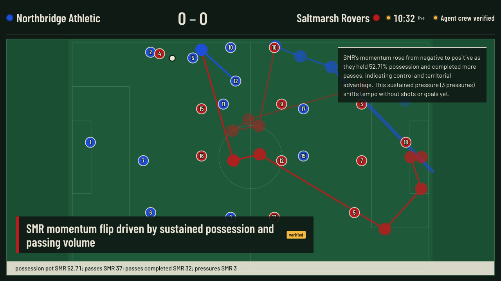

# Beyond the Scoreline

Synthetic match intelligence engine for the Microsoft + Premier League **Inside the Game: Developer Hackathon**. Category: Best Use of Microsoft Foundry.

A seeded generator plays a football-realistic match event by event. A deterministic layer turns events into statistics, momentum and key moments. A crew of Microsoft Agent Framework agents on a Microsoft Foundry model (a tactical analyst, a narrator and a fact checker) explains why each moment matters, a producer re-checks every claim against the numbers, and the result is rendered as timed overlay cues and a live web UI, personalized for analysts or fans in English or Spanish. A question desk ("Ask the match") answers free-text questions about the match on screen from its data only, with citations checked against the statistics. With narration on, Azure AI Speech reads each verified insight and the full-time recap aloud, in the viewer's language and register. A synthetic tracking layer turns the events into the positions of the 22 players and the ball, four times a match second, and a broadcast route renders the clean program output a studio puts on air.

All clubs, players and venues are fictional. No real league data is bundled, derived or redistributed.

## Live demo

<https://bts.ashygrass-da897bf3.eastus2.azurecontainerapps.io> (Azure Container Apps, eastus2). Pick seed 11 at 30×, press play; insights labelled `Agent crew` with a `verified` badge come from `gpt-5-mini` through Microsoft Foundry, and the timeline under each one shows what every agent did.

## The five stages, mapped to code

| Stage | What happens | Where |
|---|---|---|
| 1 Ingest | Seeded simulator emits passes, carries, shots, duels, pressures, fouls, cards and substitutions with pitch coordinates and xG | `src/bts/sim/` |
| 2 Interpret | Incremental possession, pass accuracy, shots, xG, pressures, final-third entries, observable momentum; rule-based key moments | `src/bts/stats/` |
| 3 Explain | Agent Framework crew (analyst with tools, narrator, fact checker, producer) on Foundry structured JSON, one retry, simple pipeline and template fallbacks | `src/bts/insights/crew/`, `src/bts/insights/` |
| 4 Render | Lower third, side panel and ticker cues with `t_start` and `duration_s`; SSE stream; REST endpoints; synthetic tracking frames at 4 fps; the broadcast program output | `src/bts/insights/cues.py`, `src/bts/api/`, `src/bts/tracking/`, `web/src/Broadcast.tsx` |
| 5 Personalize | Analyst or fan, English or Spanish, follow-your-club mode, profiles in Azure Cosmos DB; "Ask the match": a grounded Q&A agent with tools over the live match and a citation check (`docs/ASK_THE_MATCH.md`); spoken insights and recap with Azure AI Speech, one neural voice per language and profile | `web/`, `src/bts/store/`, `src/bts/insights/qa/`, `src/bts/speech/` |

Architecture diagram and data flow: `docs/ARCHITECTURE.md`. Judging criteria to evidence: `docs/RUBRIC_MAP.md`.

## Microsoft and Azure services

- **Microsoft Foundry**: `gpt-5-mini` through the Responses API with JSON-schema structured outputs, for every agent turn and the recap (`docs/FOUNDRY.md`).
- **Microsoft Agent Framework**: the four-role crew, its tools over the shared match context and the sequential workflow (`docs/AGENTS_CREW.md`); the "Ask the match" agent with eleven tools over the live session (`docs/ASK_THE_MATCH.md`).
- **Application Insights**: OpenTelemetry traces of every agent, model call and tool call, also visible in Foundry tracing (`docs/DEPLOY.md`).
- **Azure Container Apps**: the single container, external ingress, scale-to-zero outside the judging window (`docs/DEPLOY.md`).
- **Azure Cosmos DB**: user profiles, free tier.
- **Azure AI Speech**: neural text to speech (REST) for the narration switch and the recap's Listen button; clips cached per match, pulled by the client, never on the stream's path (`docs/DEPLOY.md`).
- **GitHub Copilot and Azure MCP Server**: `AGENTS.md`, `.github/copilot-instructions.md`, `.vscode/mcp.json` (`docs/COPILOT_USAGE.md`).

## Run locally

Backend (Python 3.12, [uv](https://docs.astral.sh/uv/)):

```bash
uv sync
uv run uvicorn --factory bts.api.app:create_app --reload
```

Web UI (Node 22, pnpm), in a second terminal; it proxies `/api` to port 8000:

```bash
pnpm -C web install
pnpm -C web dev
```

Open <http://localhost:5173>, pick a seed (11 is a good first match), press play. Without a Foundry endpoint every insight comes from the bilingual templates; copy `.env.example` to `.env` to use Microsoft Foundry (see `docs/FOUNDRY.md`). `BTS_AGENT_MODE=simple` swaps the crew for the two-prompt pipeline; `BTS_QA_ENABLED=false` hides the "Ask the match" desk (on by default whenever the crew is on). Narration needs `BTS_SPEECH_KEY` and `BTS_SPEECH_REGION` (see `docs/DEPLOY.md`); `BTS_SPEECH_ENABLED=false` hides the switch. `BTS_TRACKING_ENABLED=false` hides the tracking switch and the frames endpoint (on by default).

One container with everything, as deployed:

```bash
docker build -t bts .
docker run --rm -p 8000:8000 --env-file .env bts
```

Checks: `uv run pytest`, `uv run ruff check .`, `pnpm -C web typecheck && pnpm -C web test && pnpm -C web build`.

## Broadcast output



The **Broadcast** button next to Play opens `#/broadcast?match=<id>&profile=analyst&lang=en` in a new tab: a 1280×720 program output scaled to any 16:9 viewport, with the scoreboard, the pitch, the producer's timed overlays, an "Agent crew verified" marker that lights while the lower third on air passed the checks, and the tracking dots. No controls, no feeds: point a studio monitor or an OBS browser source at it. `&narration=1` adds a Start narration button (audio needs a click), `&tracking=0` hides the dots.

The **Tracking** switch on the dashboard draws the same dots on the pitch monitor. They come from `bts.tracking`, a deterministic layer with no model: the ball follows the events at their recorded speeds, every player moves toward the next event they take part in or their formation home at no more than 9 m/s, and `GET /api/matches/{id}/tracking?from_t&to_t` serves the frames (schema in `docs/DATA.md`).

## Synthetic data realism

Every match comes from our own seeded generator (`bts.sim`): a fictional four-club league, possessions modelled as a Markov chain over pitch zones, player attributes, and a hidden momentum state that the stats layer has to rediscover. `uv run python scripts/realism_check.py` simulates 200 matches (seeds 1000 to 1199) and compares the means with approximate top-flight ranges used as design targets:

| metric | value | target | ok |
|---|---|---|---|
| goals_per_match | 2.600 | 2.2 to 3.4 | yes |
| shots_per_match | 26.305 | 20 to 32 | yes |
| passes_per_match | 891.680 | 800 to 1100 | yes |
| pass_accuracy | 0.783 | 0.76 to 0.88 | yes |
| fouls_per_match | 25.180 | 16 to 30 | yes |
| home_possession | 0.511 | 0.45 to 0.55 | yes |

The event format is documented in `docs/DATA.md`; JSON Schemas live in `docs/schema/`.

## Seeds worth watching

- `11`: Northbridge Athletic vs Saltmarsh Rovers, three away goals and a late home reply (1-3).
- `5`: a goalless draw with the momentum swinging both ways.
- `1000` to `1199`: the realism check set.

## Cost notes

A match produces 13 to 22 key moments; each requested variant costs two short Foundry calls per moment plus one recap. Variants are generated on demand and cached. A question to the desk costs one agent run (usually one tool round, about 5 s). Narrating a whole match is about 5 K Speech characters per variant, within the free tier's 0.5 M a month. The deployment runs on the Container Apps consumption grant with one warm replica only during judging.

## License

MIT. See `LICENSE`.
