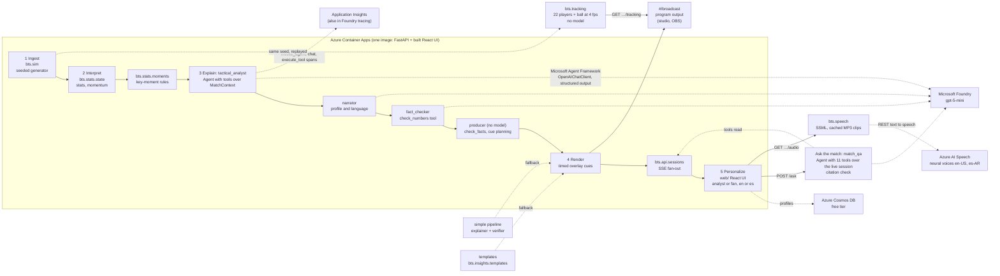

# Architecture

One container, five stages, two audiences, two languages.

## Data flow for one match

1. `POST /api/matches` builds the fictional league from the seed and starts a `MatchSession` (background task). The simulator yields events lazily; the session sleeps `(t_next - t_prev) / speed` between them.
2. Every event is ingested into `MatchState` (possession, passes, xG, pressures, final-third entries, observable momentum) and shown to `KeyMomentDetector` (goal, big chance, momentum shift, pressure spike, milestone, card, period end).
3. Each moment is published over SSE and sent to `InsightService.for_moment` for the default variant (analyst, English) and for every variant a client is subscribed to. The service hands the moment to the agent crew (below); if the crew raises, the simple pipeline (explainer, deterministic fact check, verifier, one retry) takes over, and the bilingual templates are the last resort. Results are cached per `(moment, profile, language)`; concurrent requests share one task.
4. Insights become cues: lower third (8 s), side panel (20 s), ticker (12 s, analyst only), each with `t_start` and `duration_s` so a rendering partner can draw them in sync with the clock. The producer plans them against the variant's cue history, anchored at the match clock when the insight is ready (when it goes on air), so two cues never overlap on a layer: a cue waits when the running one has at most 10 real seconds left, otherwise it takes the layer and the running cue is republished cut short under its own `cue_id`; a goal or a red card takes the lower third at once. The UI scales every window by playback speed.
5. The UI switches profile or language by reconnecting the stream; the backend generates the missing variants on demand. Profiles persist in Cosmos DB when configured.

## The agent crew

`bts.insights.crew` is a Microsoft Agent Framework system with four roles over one shared `MatchContext` (the moment, the statistics snapshot and the recent events), exposed to the model agents as tools that return name-keyed JSON (`get_moment`, `get_team_stats`, `get_player_stats`, `get_last_five_minutes`, `get_recent_events`, `get_momentum`, `check_numbers`).

| Role | Kind | Reads | Produces |
|---|---|---|---|
| `tactical_analyst` | `Agent` with tools | the brief (moment, statistics, last five minutes, momentum, recent events) and any detail it fetches | `Analysis`: the one pattern behind the moment and the numbers that prove it |
| `narrator` | `Agent` | the analysis, the profile and the language | `ExplainerOutput`: headline, why it matters, evidence, confidence |
| `fact_checker` | `Agent` with `check_numbers`, team, player and momentum tools | the draft and the statistics | `VerifierOutput`: ok or the contradictions |
| `producer` | deterministic `Executor` | the whole conversation | the decision (re-running `check_facts` on the draft) and the overlay cues |

The analysis runs once per moment and is shared by every profile and language variant. Narration, checking and production run as a `SequentialBuilder` workflow whose conversation flows from role to role, so the fact checker sees the analyst's reasoning and the narrator's draft. A rejected draft goes back to the narrator once with the issues attached; a second rejection ships the template. Every model request has a 20 s timeout at the client (one retry), each workflow 45 s, and any SDK failure raises `CrewError`, which the service turns into the simple pipeline. Each insight carries `trace: [{agent, ms, tool_calls, ok}]`, drawn in the UI as an agent timeline; the same steps are OpenTelemetry spans (`invoke_agent`, `chat`, `execute_tool`) in Application Insights when `APPLICATIONINSIGHTS_CONNECTION_STRING` is set. `BTS_AGENT_MODE=simple` switches the crew off.

Measured locally against `gpt-5-mini` with minimal reasoning: a verified insight in about 6.5 s end to end (analyst 2.9 s, narrator 2.6 s, fact checker 1.0 s, producer under 1 ms); the full-match numbers are in `docs/AGENTS_CREW.md`.

## Ask the match

`bts.insights.qa` is the question desk: one Agent Framework `Agent` (`match_qa`) on the same Foundry chat client, answering a viewer's free-text question about the match on screen from that match's data only. `QAContext` pins the session's statistics when the question arrives and exposes eleven tools over the live session (`get_score_and_clock`, `get_team_stats`, `get_player_stats`, `get_top_players`, `get_lineup`, `get_last_five_minutes`, `get_momentum`, `get_moments`, `get_insight`, `get_recent_events`, `search_events`), sharing the crew's serialisation so names, never ids, reach the model. The agent returns `QAAnswer {answer, citations, confidence, grounded}`; `check_citations` re-checks every cited number against the pinned board (team- and player-qualified values resolve against that team or player, rosters included; numbers read from a crew insight count for their statistic), and the reply is `verified` only when it is grounded, cites at least one number and every citation resolves. One run per question, bounded by 20 s; any failure returns a bilingual fallback with `source: "template"`. The last three exchanges per conversation stay in memory and travel as prior messages. `POST /api/matches/{id}/ask` serves it behind `BTS_QA_ENABLED` (on whenever the crew is on), and `AskPanel` in the right rail shows the answer, its citations, a status badge and the agent step. Measured: median 4.6 s over eight sample questions (`docs/ASK_THE_MATCH.md`).

## Narration

`bts.speech` turns a verified insight (headline, pause, why it matters) or the full-time recap (title and paragraphs) into an MP3 clip through Azure AI Speech's REST text-to-speech endpoint, one neural voice per language and profile (`en-US-AndrewMultilingualNeural` and `en-US-AvaMultilingualNeural`; `es-AR-TomasNeural` and `es-AR-ElenaNeural`, the fan voices a touch quicker and brighter). The SSE stream never waits for it: the UI pulls `GET /api/matches/{id}/insights/{moment_id}/audio` once the insight is on screen and `GET /api/matches/{id}/recap/audio` from the recap dialog, and the `Narrator` caches each clip in memory per match and insight (FIFO, 512 clips) so a replay or a second viewer costs nothing. Every request has a 10 s timeout; a failure answers 503 with its reason and is never cached. The UI's narration switch queues clips one at a time, plays each insight at most once, skips a clip whose turn comes more than 60 s after it arrived, and marks the backlog as read when it is switched on mid-match. Behind `BTS_SPEECH_ENABLED` (on whenever `BTS_SPEECH_KEY` and `BTS_SPEECH_REGION` are set); `GET /api/features` tells the UI.

## Synthetic tracking

`bts.tracking` turns a match's event list into positions for the 22 players and the ball at 4 frames per match second, deterministically and without a model, so the pitch monitor shows a match rather than a scatter of markers and a renderer gets the kind of data tracking providers sell. Events are recorded in the attacking frame of the side in possession, so a possession rule (`bts.tracking.possession`, mirrored in `web/src/lib/possession.ts` for the event markers) places every event in one screen frame: both axes 0 to 100, the home side attacking left to right all match long. The ball (`bts.tracking.ball`) is at an event's end exactly at the event's time (the simulator stamps an action when it ends), leaves its start at the event's own recorded `ball_speed` or `shot_speed`, rests between restarts and bridges a kick-off or a keeper's restart at 8 m/s. Each player (`bts.tracking.tracker`) moves every frame toward a target at no more than 9 m/s (2.25 m per frame, the no-teleport guarantee): the start of the next event they take part in when it is at most 8 s away (a receiver gets there before the pass arrives), the ball while carrying it, the spot they just acted at for 2 s, or their 4-4-2 home shifted toward the ball and forward or back with possession. Substitutes enter from the halfway line, a sent-off player disappears at the card. Checked over seed 11: the median player is exactly at the spot when the ball leaves, and 27 of 1 408 anchors arrive more than 3 m late, the ones where the simulator itself asks more than 9 m/s.

`GET /api/matches/{id}/tracking?from_t&to_t` serves `[{t, ball: [x, y], players: {player_id: [x, y]}}]`, at most 600 frames per call (150 s), behind `BTS_TRACKING_ENABLED` (default on; `GET /api/features` reports `tracking`). The session replays its seed in a second simulator on the first request, so it knows every event up front and can serve frames ahead of its clock without touching the generator that feeds the stream; frames are integrated in order in a worker thread and cached compactly (600 frames in about 14 ms, a whole match in about 280 ms and 6 MB). The UI (`web/src/lib/tracking.ts`, `useTracking`, `TrackingLayer`) fetches windows ahead of the clock, interpolates between frames and draws the dots with `requestAnimationFrame` straight to the SVG, never through React state: measured in headless Chromium at 1280×720 with the match at 30×, the layer draws in 0.05 ms per frame on average (0.2 ms worst) and the page holds the display's frame rate (120 fps on the test laptop, no frame over 33 ms in 10 s).

## Broadcast output

`#/broadcast?match=<id>&profile=&lang=&narration=&tracking=` is the program output: the same SPA, a second root picked from the hash (`web/src/Broadcast.tsx`). A 1280×720 stage scaled to the viewport with one CSS transform (1280×720 and 1920×1080 show the same frame, no scroll), the shared `Scoreboard` and clock in a top band with an "Agent crew verified" marker that lights while the lower third on air passed the checks, and the shared `Pitch` full-bleed with the shared `Overlays` on the producer's timing and the tracking layer on by default. No controls, no feeds, no footer: what a studio monitor or an OBS browser source puts on air. The dashboard's Broadcast button opens it for the running match, profile and language; an unknown or finished match shows "Waiting for the match"; narration (`narration=1`) starts after one click on the stage because of the browsers' autoplay rules and never writes the dashboard's preference.

## What the badges mean

- `source: llm` with `verified: true`: the model wrote it, every cited number resolved against the named statistic within tolerance (one unit for counts, 5% for ratios), and the fact checker (or, in simple mode, a second Foundry call) found no contradiction in the prose. The badge reads `Agent crew` when the insight carries a trace and `Foundry` when the simple pipeline produced it.
- `source: llm` with `verified: false`: the numbers passed the deterministic check but the Foundry cross-check was unavailable (timeout or rate limit). The text is kept, labelled honestly.
- `source: template`: the model failed twice or was never configured; the copy is deterministic and bilingual.

## Why the model never blocks the stream

The event loop that advances the match only awaits `asyncio.sleep`. Insight generation runs in child tasks; the stream carries events and stats immediately and insights whenever they are ready. Any model failure (timeout, 429, refusal, schema mismatch) in the crew falls through to the simple pipeline and then to a template with `source: "template"` and `verified: false`, visible in the UI.

## Determinism

`sim` and `stats` are pure Python with one `random.Random(seed)`. The same seed always yields the same events, moments and template copy; only model text varies.
