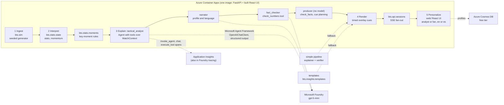

# Architecture

One container, five stages, two audiences, two languages.

## Data flow for one match

1. `POST /api/matches` builds the fictional league from the seed and starts a `MatchSession` (background task). The simulator yields events lazily; the session sleeps `(t_next - t_prev) / speed` between them.
2. Every event is ingested into `MatchState` (possession, passes, xG, pressures, final-third entries, observable momentum) and shown to `KeyMomentDetector` (goal, big chance, momentum shift, pressure spike, milestone, card, period end).
3. Each moment is published over SSE and sent to `InsightService.for_moment` for the default variant (analyst, English) and for every variant a client is subscribed to. The service hands the moment to the agent crew (below); if the crew raises, the simple pipeline (explainer, deterministic fact check, verifier, one retry) takes over, and the bilingual templates are the last resort. Results are cached per `(moment, profile, language)`; concurrent requests share one task.
4. Insights become cues: lower third (8 s), side panel (20 s), ticker (12 s, analyst only), each with `t_start` and `duration_s` so a rendering partner can draw them in sync with the clock. The producer plans them against the variant's cue history so two cues never overlap on a layer: a cue waits when the running one has at most 10 real seconds left, otherwise it takes the layer and the running cue is republished cut short under its own `cue_id`; a goal or a red card takes the lower third at once. The UI scales every window by playback speed.
5. The UI switches profile or language by reconnecting the stream; the backend generates the missing variants on demand. Profiles persist in Cosmos DB when configured.

## The agent crew

`bts.insights.crew` is a Microsoft Agent Framework system with four roles over one shared `MatchContext` (the moment, the statistics snapshot and the recent events), exposed to the model agents as tools that return name-keyed JSON (`get_moment`, `get_team_stats`, `get_player_stats`, `get_last_five_minutes`, `get_recent_events`, `get_momentum`, `check_numbers`).

| Role | Kind | Reads | Produces |
|---|---|---|---|
| `tactical_analyst` | `Agent` with tools | the brief (moment, statistics, last five minutes, momentum, recent events) and any detail it fetches | `Analysis`: the one pattern behind the moment and the numbers that prove it |
| `narrator` | `Agent` | the analysis, the profile and the language | `ExplainerOutput`: headline, why it matters, evidence, confidence |
| `fact_checker` | `Agent` with `check_numbers`, team, player and momentum tools | the draft and the statistics | `VerifierOutput`: ok or the contradictions |
| `producer` | deterministic `Executor` | the whole conversation | the decision (re-running `check_facts` on the draft) and the overlay cues |

The analysis runs once per moment and is shared by every profile and language variant. Narration, checking and production run as a `SequentialBuilder` workflow whose conversation flows from role to role, so the fact checker sees the analyst's reasoning and the narrator's draft. A rejected draft goes back to the narrator once with the issues attached; a second rejection ships the template. Every turn has a timeout (20 s per agent, 45 s per workflow) and any SDK failure raises `CrewError`, which the service turns into the simple pipeline. Each insight carries `trace: [{agent, ms, tool_calls, ok}]`, drawn in the UI as an agent timeline; the same steps are OpenTelemetry spans (`invoke_agent`, `chat`, `execute_tool`) in Application Insights when `APPLICATIONINSIGHTS_CONNECTION_STRING` is set. `BTS_AGENT_MODE=simple` switches the crew off.

Measured locally against `gpt-5-mini` with minimal reasoning: a verified insight in about 6.5 s end to end (analyst 2.9 s, narrator 2.6 s, fact checker 1.0 s, producer under 1 ms); the full-match numbers are in `docs/AGENTS_CREW.md`.

## What the badges mean

- `source: llm` with `verified: true`: the model wrote it, every cited number resolved against the named statistic within tolerance (one unit for counts, 5% for ratios), and the fact checker (or, in simple mode, a second Foundry call) found no contradiction in the prose. The badge reads `Agent crew` when the insight carries a trace and `Foundry` when the simple pipeline produced it.
- `source: llm` with `verified: false`: the numbers passed the deterministic check but the Foundry cross-check was unavailable (timeout or rate limit). The text is kept, labelled honestly.
- `source: template`: the model failed twice or was never configured; the copy is deterministic and bilingual.

## Why the model never blocks the stream

The event loop that advances the match only awaits `asyncio.sleep`. Insight generation runs in child tasks; the stream carries events and stats immediately and insights whenever they are ready. Any model failure (timeout, 429, refusal, schema mismatch) in the crew falls through to the simple pipeline and then to a template with `source: "template"` and `verified: false`, visible in the UI.

## Determinism

`sim` and `stats` are pure Python with one `random.Random(seed)`. The same seed always yields the same events, moments and template copy; only model text varies.
