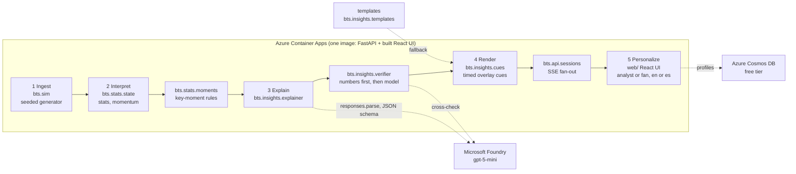

# Architecture

One container, five stages, two audiences, two languages.

## Data flow for one match

1. `POST /api/matches` builds the fictional league from the seed and starts a `MatchSession` (background task). The simulator yields events lazily; the session sleeps `(t_next - t_prev) / speed` between them.
2. Every event is ingested into `MatchState` (possession, passes, xG, pressures, final-third entries, observable momentum) and shown to `KeyMomentDetector` (goal, big chance, momentum shift, pressure spike, milestone, card, period end).
3. Each moment is published over SSE and sent to `InsightService.for_moment` for the default variant (analyst, English) and for every variant a client is subscribed to. The service explains with the model, checks every cited number against the snapshot and the moment's facts, asks the model to cross-check the prose, retries once with the issues, and falls back to the bilingual templates. Results are cached per `(moment, profile, language)`; concurrent requests share one task.
4. Insights become cues: lower third (8 s), side panel (20 s), ticker (12 s, analyst only), each with `t_start` and `duration_s` so a rendering partner can draw them in sync with the clock. The UI scales the window by playback speed.
5. The UI switches profile or language by reconnecting the stream; the backend generates the missing variants on demand. Profiles persist in Cosmos DB when configured.

## What the badges mean

- `source: llm` with `verified: true`: the model wrote it, every cited number resolved against the named statistic within tolerance (one unit for counts, 5% for ratios), and a second Foundry call found no contradiction in the prose.
- `source: llm` with `verified: false`: the numbers passed the deterministic check but the Foundry cross-check was unavailable (timeout or rate limit). The text is kept, labelled honestly.
- `source: template`: the model failed twice or was never configured; the copy is deterministic and bilingual.

## Why the model never blocks the stream

The event loop that advances the match only awaits `asyncio.sleep`. Insight generation runs in child tasks; the stream carries events and stats immediately and insights whenever they are ready. Any model failure (timeout 20 s, 429, refusal, schema mismatch) ends in a template with `source: "template"` and `verified: false`, visible in the UI.

## Determinism

`sim` and `stats` are pure Python with one `random.Random(seed)`. The same seed always yields the same events, moments and template copy; only model text varies.
